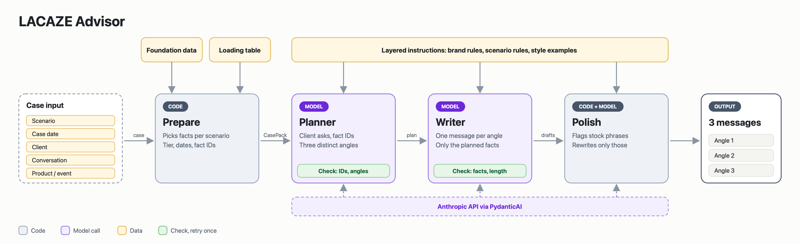

<h1 align="center">
  <picture>
    <source media="(prefers-color-scheme: dark)" srcset="assets/lacaze-logo-white.svg">
    
  </picture>
  <br>
  Advisor
</h1>

<p align="center">Drafts three WeChat messages for a luxury Client Advisor, grounded in what the store actually knows about the client and the product.</p>

Given a client, the conversation so far and a scenario, it returns three candidate messages in Chinese, each taking a different angle. The advisor picks one, edits it and sends it. Nothing is sent automatically.

> LACAZE is a fictional brand. All clients, products, services and events in this repository are invented.

## Example

Scenario: *Price objection*. A recent graduate is choosing her first LACAZE bag.

> **Client** · 想买第一只你们家的包，平时出门东西不多。<br>
> **Advisor** · 许小姐，可以看看 Colette，3.5 万元，放手机、卡包、钥匙都合适。<br>
> **Client** · 挺喜欢的，不过对我来说有点贵。<br>
> **Client** · 你们有新客优惠或者学生价吗？我刚毕业没多久哈哈。

The brand does not discount, and the advisor must say so without sounding scripted or pushing. The tool returns three candidates, each from a different angle:

**1 · State the policy plainly**
> 许小姐，直接回答您：针对新客或学生的特别价格，我们都没有。LACAZE 全国官方门店统一定价，不打折、不议价，也没有会员折扣，Colette 是 35,000 元。有什么想了解的随时问我。

**2 · Acknowledge the budget first**
> 许小姐，刚毕业，对价格多掂量一下很正常。新客和学生的专属价格我们确实没有，全国门店都是统一定价，不打折。您说平时出门东西不多，Colette 能放下手机（6.7 英寸以内）、卡包、钥匙和口红，您可以对照自己的日常看看合不合适。

**3 · Explain what the price includes**
> 许小姐，新客和学生的专属价格都没有，我们不打折也不议价。不过在官方门店购买的手袋，每年可以免费做一次基础护理，内侧皮标也可以免费烫印最多三个首字母。Colette 用的是小羊皮，链条是手工逐节打磨的。您想再考虑也完全可以，若想先看看实物、试背，到时跟我约时间就好。

## How it works



1. **Prepare** (code, no model). A loading table decides, per scenario, which facts the case needs: products, services, policies, events, calendar, purchases. Every fact gets an ID. Client tier, eligibility and dates are computed, not asked of a model.
2. **Planner** (one call). Reads the client, the history and the facts. Lists what the client asked, which facts apply, what to avoid, and three different angles. Code checks that every cited ID exists.
3. **Writer** (one call). Writes one message per angle, seeing only the facts the plan chose. Code checks prices, dates, product scope, internal terms, salutation and length; a hard failure gets one rewrite with feedback.
4. **Polish.** Code flags sentences that match known problem patterns (reassurance nobody asked for, defensive non-answers). Only those sentences are rewritten.

It is a fixed workflow, not an autonomous agent: no tools, no database, no retrieval beyond the loading table.

## Quick start

Requires Python 3.13 and [uv](https://docs.astral.sh/uv/).

```sh
uv sync --locked
cp .env.example .env        # set ANTHROPIC_API_KEY
uv run lacaze validate-data
uv run lacaze generate --case-id C12
```

`LACAZE_MODEL` selects the model (default `claude-sonnet-5-5`). Set `ANTHROPIC_BASE_URL` and `ANTHROPIC_AUTH_TOKEN` only when going through a proxy.

### Your own case

```sh
uv run lacaze generate --input new-case.json
```

```json
{
  "case_id": "new_case",
  "scenario": "Birthday and festive greetings",
  "case_date": "2026-11-06",
  "client_information": {"client_id": "cl004"},
  "conversation_history": [],
  "product_information": {"product_ids": [], "event_id": null}
}
```

- `scenario` is one of six: `Birthday and festive greetings`, `Product recommendation`, `Post-purchase care`, `Reactivation`, `Event invitation`, `Price objection`.
- `case_date` is required. It is the business date of the case; the machine's date is never used.
- A known client is given by `client_id` alone. Name, birthday, purchases, tier and spend come from `data/foundation/`.
- A new client is written inline: `{"name": "周敏", "salutation": "周女士"}`. Purchases are then treated as unknown.
- `product_information` holds `product_ids` and an optional `event_id`.
- History is chronological, with unique `message_id` values, none after `case_date`.

The full contract is `src/lacaze/domain/models.py`.

### Batches

```sh
uv run lacaze batch --case-ids C02 C07 C10 --output-dir artifacts/my-run
uv run lacaze batch --concurrency 2
```

Output directories must be new. Each case writes `Cxx.json` (input, plan, drafts, warnings, token usage) as soon as it finishes; `outputs.csv` and `summary.json` are written at the end, with `configuration.json` recording the exact data and prompts used.

### HTTP

```sh
uv run uvicorn lacaze.interfaces.api:app --host 127.0.0.1 --port 8000
```

`POST /generate` takes a case and returns the same result as the CLI. `GET /scenarios` lists the six scenarios, `GET /health` reports readiness, and `/docs` has the interactive schema. Intended for local use.

### Hosting

`render.yaml` deploys the app to Render; enter `ANTHROPIC_API_KEY` in the Render dashboard. `LACAZE_DAILY_GENERATION_LIMIT` caps generations per UTC day (100 in `render.yaml`), and a spending limit on the API key is the backstop. Setting `LACAZE_ACCESS_CODE` puts every page behind the browser's sign-in prompt (any user name, the code as password). Render's own host name is allowed automatically; other host names go in `LACAZE_ALLOWED_HOSTS`.

## Evaluation

`lacaze evaluate` scores existing runs against a rubric; it never regenerates messages.

| Level | Meaning |
|---|---|
| Not acceptable | Fabricates facts, crosses a brand red line, or contradicts what the client said |
| Needs edit | Safe, but not yet personal, natural and on-brand, or not responding to the moment |
| Good | Passes all six indicators |

```sh
uv run lacaze evaluate prepare --run artifacts/my-run --out artifacts/eval --judge-model claude-opus-5-5
# one independent judge per packets/Cxx.md writes judgments/Cxx.json
uv run lacaze evaluate collect --eval-dir artifacts/eval
```

Packets are blind: no app version, run name or code flags. Labels are computed by code from the judge's yes/no answers. The rubric, judge prompt and schema are in `data/evaluation/`; `collect` refuses judgments if any of them changed after `prepare`.

On the 50 test cases in `data/cases/`, v0.2.3 produced 75 Good, 54 Needs edit and 21 Not acceptable messages out of 150, and at least one Good message in 43 of 50 cases.

## Project layout

```text
src/lacaze/
  domain/          Contracts: input, case pack, plan, drafts, result
  application/     Preparation, Planner and Writer, code checks, polish, workflow, batch
  infrastructure/  Data loading, settings, model client
  interfaces/      CLI and HTTP
  evaluation/      Judge packets, code checks, labels, reports
data/
  foundation/      Brand, products, services, policies, events, calendar, clients, purchases
  context/         Loading table, draft checks, polish patterns
  prompts/         Planner, Writer and polish instructions
  cases/           Development (10) and test (40) cases
  evaluation/      Rubric, judge prompt, schema, phrase lists
tests/             Offline tests with a scripted model
```

`LACAZE_DATA_DIR` points the app at data stored elsewhere.

## Development

```sh
uv run pytest -q
uv run ruff check src scripts tests
```

The tests drive the real workflow with PydanticAI's `FunctionModel`: preparation, what each stage sees, plan and draft checks, retries, polish, HTTP validation and batch files. They do not judge the model's language quality; that is what `lacaze evaluate` is for.

Built with PydanticAI, Pydantic 2 and the Anthropic API.
