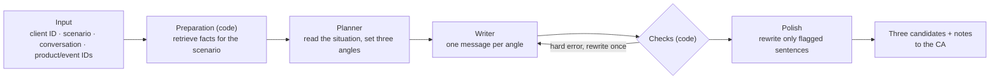

# 1. Tool design

The brief asks for messages that feel personal and unmistakably on-brand, arrive at the right moment, and never sound scripted, pushy or intrusive; each time the tool gives three candidates, across all six scenarios. I turned this into four design goals:

1. **Accurate**: every price, specification or event detail has a source; nothing is invented.
2. **Fits the scenario**: the six scenarios have different purposes; a birthday greeting does not sell, a price objection does not discount.
3. **Personal, arriving at the right moment**: built on what is known about this client, and answering where the client is right now.
4. **On-brand, not scripted, pushy or intrusive**: restrained, within the brand's red lines, not templated, no pressure, no prying.

The tool is split into stages, each responsible for part of this:

## 1.1 Accurate: fact-driven

The input is only IDs. Prices, sizes, event times and purchase records are retrieved by code from the store data and assembled into a numbered list of facts. The model may use only facts from that list; if a message contains a price, date or product outside it, the checks send it back for a rewrite. Accuracy stops being a question of whether the model remembers correctly and becomes a question of whether the data is complete.

Information also narrows from stage to stage. The Planner sees every fact, including internal ones such as who an event is open to; the Writer receives only the facts the Planner selected that may be said to the client.

## 1.2 Fits the scenario: different information and rules per scenario

For the same client, what an advisor needs to know on her birthday is completely different from what they need when she finds a bag too expensive. So each scenario has its own configuration: a goal, the situations it may involve, rules for the Planner and the Writer, a tone example, and which facts to retrieve.

| Scenario | Goal | Situations | Information injected |
|---|---|---|---|
| Birthday and festive greetings | A natural, measured greeting | Birthday, festival | Festival calendar, product positioning |
| Product recommendation | Candidates based on real needs, helping the client compare | New use, replacement, comparing options, first enquiry | Full specifications and prices, allocation policy, in-store viewing |
| Post-purchase care | Care around a purchased bag, or answering a usage request | Routine follow-up, usage request, suspected fault | Leather, structure and care; five store services |
| Reactivation | Reconnecting on the basis of the relationship | A factual reason to reach out, a simple greeting | Last contact date, upcoming events, care and viewing services |
| Event invitation | An optional invitation tied to the client's interests | First invitation, follow-up reply | Event details, craft of the featured bags, allocation policy |
| Price objection | Addressing the specific concern, explaining value and policy, respecting the decision | Over budget, comparing channels, asking for a discount | Price and product value, pricing and channel policy, store services |

The brand's identity, tone and red lines are injected every time, whatever the scenario.

## 1.3 Personal, right moment: judge first, then write

The Planner writes no message. It only judges: where the client is now, which points they asked this time, which past messages and purchases can be referred to, what to avoid, and which questions the available facts cannot answer. On that basis it sets three angles, each with a core point, a purpose, and the messages it draws on.

The Writer writes one message per angle, and each message must answer every point the client asked. Where the facts cannot answer a question, the Writer says plainly that it is best seen in person, rather than inventing an answer.

## 1.4 On-brand, not scripted, pushy or intrusive: code checks and local polish

Only the Planner sees the client's tier and spend; the Writer never receives them, so messages cannot lean on status.

After writing, code checks each message:

- **Hard errors are sent back for one rewrite**: banned brand phrases, internal information, a missing salutation, exceeding the length limit.
- **Soft issues are only flagged to the CA, not rewritten**: for example, three messages worded too similarly, or an exclamation mark.

There is only one retry, because endless rewriting is costly and tends to drift further off course.

For wording problems that recur, the tool only polishes locally: code matches known problem patterns sentence by sentence, sends only the matching sentences to the model to rewrite or delete, checks that nothing new was added, and puts them back in place. Every other sentence stays exactly as written.
