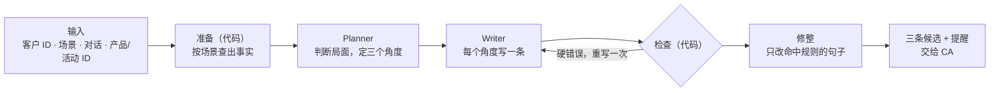

# 1. 工具设计

题目对消息的要求是：feel personal and unmistakably on-brand，arrive at the right moment，never sound scripted, pushy or intrusive；每次给出三条候选，覆盖全部六个场景。我把它整理成四个设计目标：

1. **准确**：价格、规格、活动等具体信息都有出处，不编造。
2. **贴合场景**：六个场景的目的各不相同，生日问候不推销，价格异议不让价。
3. **Personal，arrive at the right moment**：基于这位客户的已知信息，回应客户此刻的状态和问题。
4. **On-brand，不 scripted、pushy、intrusive**：语气克制，不越过品牌红线，不像模板，不施压，不打探。

工具拆成几个环节，各自负责一部分：

## 1.1 准确：事实驱动

输入只有 ID。价格、尺寸、活动时间、购买记录，都由代码从门店数据里查出来，整理成一份带编号的事实清单。模型只能使用清单里的事实；消息里出现清单之外的价格、日期或产品，检查环节会退回重写。事实问题因此从"模型记得对不对"变成了"数据查得全不全"。

信息也随环节逐步收窄。Planner 看得到全部事实，包括活动参加范围这类只供内部判断的信息；Writer 只拿到 Planner 选定的、可以对客户说的事实。

## 1.2 贴合场景：不同场景，注入不同的信息和规则

同样一位客户，生日那天和她嫌贵的时候，顾问需要知道的信息完全不同。所以每个场景有自己的一套配置：目标、可能的情况类型、给 Planner 和 Writer 的规则、一条语气示例，以及要查哪些事实。

| 场景 | 目标 | 情况类型 | 注入的信息 |
|---|---|---|---|
| 生日与节日 | 送上自然、适度的祝福 | 生日、节日 | 节日日历、产品定位 |
| 商品推荐 | 基于实际需求给出候选，帮客户比较 | 新增用途、替换现有、比较候选、初次了解 | 完整规格与价格、配额政策、看实物服务 |
| 售后关怀 | 围绕已购商品关怀，或回应使用请求 | 普通回访、使用请求、疑似故障 | 皮料、结构与保养，五项门店服务 |
| 唤醒 | 以有关系依据的方式恢复联系 | 有事实由头、单纯问候 | 上次联系时间、近期活动、护理与看实物服务 |
| 活动邀请 | 结合客户兴趣，提供可选择的邀请 | 首次邀请、跟进回复 | 活动详情、相关产品的工艺、配额政策 |
| 价格异议 | 回应具体顾虑，说明价值与政策，尊重客户决定 | 超预算、渠道比价、折扣请求 | 价格与产品价值、定价与渠道政策、门店服务 |

品牌的身份、语气和红线则每次都注入，不分场景。

## 1.3 Personal，right moment：先判断，再动笔

Planner 不写消息，只做判断：客户现在处于什么状态，这次明确问了哪几点，有哪些可以呼应的过往对话和购买记录，要避免什么，哪些问题现有资料答不了。在此基础上，它给出三个角度，每个角度写明核心意思、要达成什么、依据哪几句对话。

Writer 按这三个角度各写一条，每条都要回应客户问到的每一点。资料答不了的问题，Writer 照实说"要看实物"，不编答案。

## 1.4 On-brand，不 scripted、pushy、intrusive：代码把关与局部修整

客户层级和消费金额只有 Planner 看得到，Writer 拿不到，消息里也就不会以身份施压。

写完之后由代码把关：

- **硬错误退回重写一次**：品牌禁用语、内部信息、没用称呼、超出字数。
- **软问题只提醒 CA，不重写**：比如三条措辞过于相似、出现感叹号。

重试只给一次，因为无限重写既贵，也容易越改越偏。

对于反复出现的措辞问题，工具只做局部修整：代码按句子匹配已知的问题模式，只把命中的句子交给模型改写或删除，改完再检查有没有加进新信息，然后拼回原文。其余句子一字不动。
