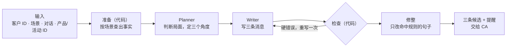

# 1. 工具设计

一条好的顾问消息要同时做对四件事：事实准确，判断得当（读懂客户此刻的状态，知道该回应什么、该避免什么），措辞自然且有品牌感，三条候选之间是真正不同的选择。让一个模型一次完成全部，每一件都容易出错。所以整体设计只有一个原则：**把这四件事拆开，交给最适合的环节。**

## 1.1 事实驱动

输入只有 ID。价格、尺寸、活动时间、购买记录，都由代码从门店数据里查出来，整理成一份带编号的事实清单。模型只能引用清单里的事实，消息里出现清单之外的价格、日期或产品，检查环节就会拦下。这样每条消息里的具体信息都有出处，事实问题从"模型记得对不对"变成了"数据查得全不全"。

## 1.2 分层注入

不同信息的作用范围不同，所以分三层注入：

- **品牌层**，每次都注入：品牌身份、语气、红线。
- **场景层**，按场景注入：这个场景的目标、可能的情况类型、写作要求和一条语气示例。
- **用例层**，按用例注入：客户档案、对话历史、按场景查出的事实。

用例层查哪些事实，由一张场景对照表决定。生日问候只需要节日和客户信息；价格异议则需要价格、定价政策和门店服务，用来解释价值而不是让价：

| 场景 | 产品信息 | 门店服务 | 政策 | 活动 | 其他 |
|---|---|---|---|---|---|
| 生日与节日 | 定位 | — | — | — | 节日日历 |
| 商品推荐 | 定位、价格、尺寸、重量、开合、内部、背法、颜色、能装什么、工艺 | 看实物与试背 | 配额 | — | — |
| 售后关怀 | 皮料、开合、内部、背法、保养 | 使用演示、年度护理、维修评估、烫印、专属顾问 | — | — | — |
| 唤醒 | 定位 | 年度护理、看实物与试背 | — | 近期活动 | 上次联系时间 |
| 活动邀请 | 定位、配额、工艺 | — | 配额 | 本次活动 | — |
| 价格异议 | 定位、价格、配额、皮料、背法、能装什么、工艺 | 年度护理、维修评估、烫印、看实物与试背 | 定价、渠道、配额 | — | — |

信息也随环节逐步收窄。Planner 看得到全部事实，包括活动参加范围这类只供内部判断的信息；Writer 只拿到 Planner 选定的、可以对客户说的事实，也看不到客户层级和消费金额。

## 1.3 判断与措辞分离

Planner 不写消息，只做判断：客户现在处于什么状态，这次明确问了哪几点，要避免什么，哪些问题现有资料答不了，三条消息分别从什么角度切入。Writer 按计划写，不再重新判断。资料答不了的问题由 Planner 事先标出，Writer 就照实说"要看实物"，而不是编一个答案。

## 1.4 三个角度，一份事实

三条候选的差异来自角度，而不是措辞：比如一条直接回答问题，一条从客户已有的包出发，一条提出到店看实物。三个角度共用同一份事实，每条都要回应客户问到的每一点。代价是三条之间的差异变小。我们选择完整性，因为 CA 最后只发一条，每一条都应该能直接发出。

## 1.5 代码把关，有限重试

Writer 的输出由代码逐条检查：

- **硬错误退回重写一次**：清单之外的价格、日期或产品，内部信息，品牌禁用语，没用称呼，超出字数。
- **软问题只提醒、不重写**：比如三条措辞过于相似、出现感叹号。

重试只给一次。无限重写既贵，也容易越改越偏；剩下的问题以提醒的形式交给 CA。

## 1.6 局部修整

模型写中文消息有固定的坏习惯，比如"您不用特意回复"这类多余的安抚，"这个我这边没有信息"这类防御式说法。代码按句子匹配这些模式，只把命中的句子交给模型改写或删除，改完再检查有没有加进新的价格、产品，或者丢了称呼，再拼回原文。没命中的句子一字不动。
