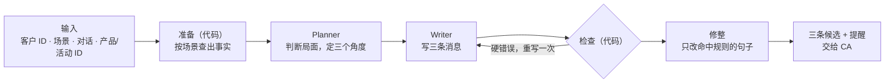

# 1. 工具设计

题目对消息的要求是：feel personal and unmistakably on-brand，arrive at the right moment，never sound scripted, pushy or intrusive；每次给出三条候选，由 CA 选择。我把它整理成四个设计目标：

1. **准确**：价格、规格、活动等具体信息都有出处，不编造。
2. **Personal，arrive at the right moment**：基于这位客户的已知信息，回应客户此刻的状态和问题。
3. **On-brand，不 scripted、pushy、intrusive**：语气克制，不越过品牌红线，不像模板，不施压，不打探。
4. **三条真选择**：三条候选是三种不同的思路，每一条都能直接发出。

让一个模型一次完成全部，每个目标都容易出错。所以整个工具拆成几个环节，各自负责一部分：

| 目标 | 主要靠哪个设计 |
|---|---|
| 准确 | 1.1 事实驱动，分层注入 |
| Personal，right moment | 1.2 先判断，再动笔 |
| On-brand，不 scripted、pushy、intrusive | 1.3 品牌约束与局部修整 |
| 三条真选择 | 1.4 三个角度，一份事实 |

## 1.1 准确：事实驱动，分层注入

输入只有 ID。价格、尺寸、活动时间、购买记录，都由代码从门店数据里查出来，整理成一份带编号的事实清单。模型只能使用清单里的事实；消息里出现清单之外的价格、日期或产品，检查环节会退回重写。事实问题因此从"模型记得对不对"变成了"数据查得全不全"。

查哪些事实，由场景决定。生日问候只需要节日和客户信息；价格异议需要价格、定价政策和门店服务，用来解释价值，而不是让价：

| 场景 | 产品信息 | 门店服务 | 政策 | 活动 | 其他 |
|---|---|---|---|---|---|
| 生日与节日 | 定位 | — | — | — | 节日日历 |
| 商品推荐 | 定位、价格、尺寸、重量、开合、内部、背法、颜色、能装什么、工艺 | 看实物与试背 | 配额 | — | — |
| 售后关怀 | 皮料、开合、内部、背法、保养 | 使用演示、年度护理、维修评估、烫印、专属顾问 | — | — | — |
| 唤醒 | 定位 | 年度护理、看实物与试背 | — | 近期活动 | 上次联系时间 |
| 活动邀请 | 定位、配额、工艺 | — | 配额 | 本次活动 | — |
| 价格异议 | 定位、价格、配额、皮料、背法、能装什么、工艺 | 年度护理、维修评估、烫印、看实物与试背 | 定价、渠道、配额 | — | — |

信息也随环节逐步收窄。Planner 看得到全部事实，包括活动参加范围这类只供内部判断的信息；Writer 只拿到 Planner 选定的、可以对客户说的事实。

## 1.2 Personal，right moment：先判断，再动笔

Planner 不写消息，只做判断：客户现在处于什么状态，这次明确问了哪几点，有哪些可以呼应的过往对话和购买记录，要避免什么，哪些问题现有资料答不了。Writer 按这份计划写，每条都要回应客户问到的每一点。资料答不了的问题，Writer 照实说"要看实物"，不编答案。

## 1.3 On-brand，不 scripted、pushy、intrusive：品牌约束与局部修整

品牌的身份、语气和红线每次都注入给 Planner 和 Writer，每个场景再叠加自己的写作要求和一条语气示例。客户层级和消费金额只有 Planner 看得到，Writer 拿不到，消息里也就不会以身份施压。

写完之后由代码把关：

- **硬错误退回重写一次**：品牌禁用语、内部信息、没用称呼、超出字数。
- **软问题只提醒 CA，不重写**：比如三条措辞过于相似、出现感叹号。

重试只给一次，因为无限重写既贵，也容易越改越偏。

模型写中文消息还有一些固定的"模板腔"，比如"您不用特意回复"这类多余的安抚，"这个我这边没有信息"这类防御式说法。代码按句子匹配这些模式，只把命中的句子交给模型改写或删除，改完再检查有没有加进新信息，然后拼回原文。没命中的句子一字不动。

## 1.4 三条真选择：三个角度，一份事实

三条候选的差异来自角度，而不是措辞。比如一条直接回答问题，一条从客户已有的包出发，一条提出到店看实物。三个角度共用同一份事实，每条都完整回应客户。代价是三条之间的差异变小。我们选择完整性，因为 CA 最后只发一条，每一条都应该能直接发出。
