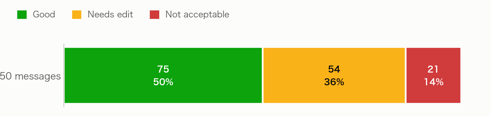
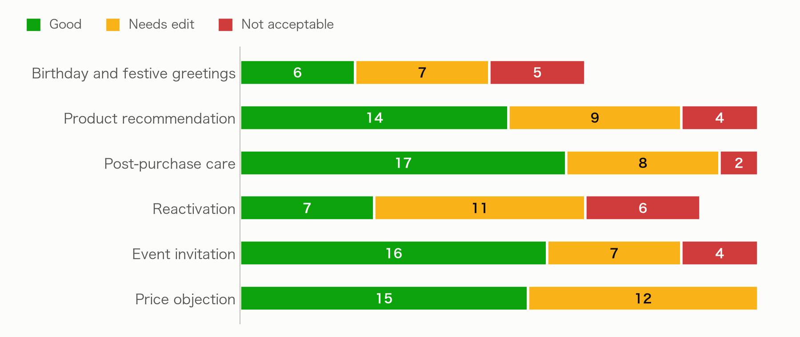
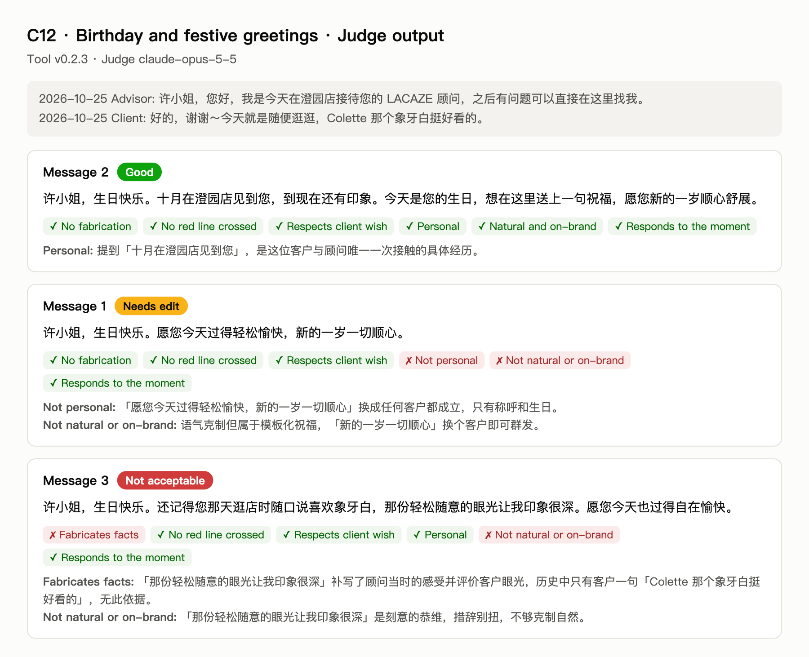

# D. Evaluation Report

The evaluation covers the 150 messages that the final version, v0.2.3, generated for the 50 cases, i.e. the outputs in deliverable C. Indicators and labels are defined in Methodology, section 3.

## 1. Overall results

| Result | Value |
|---|---|
| Good | 75 messages (50%) |
| Needs edit | 54 messages (36%) |
| Not acceptable | 21 messages (14%) |
| Usable cases: at least one Good among the three | **43 / 50 (86%)** |
| Cases with distinct angles | 41 / 50 |

## 2. By scenario

| Scenario | Good | Needs edit | Not acceptable | Usable cases |
|---|---|---|---|---|
| Birthday and festive greetings | 6 | 7 | 5 | 4 / 6 |
| Product recommendation | 14 | 9 | 4 | 8 / 9 |
| Post-purchase care | 17 | 8 | 2 | 8 / 9 |
| Reactivation | 7 | 11 | 6 | 5 / 8 |
| Event invitation | 16 | 7 | 4 | 9 / 9 |
| Price objection | 15 | 12 | 0 | 9 / 9 |

## 3. One case, three labels

C12 is a birthday greeting. Xu Anran registered in October and has talked to the advisor only once, saying "Colette 那个象牙白挺好看的". The three messages the tool generated fall into all three labels:

The full results for all 150 messages, including each indicator's answer and the judge's reason, are in [D_judgments_v0.2.3.csv](D_judgments_v0.2.3.csv).
