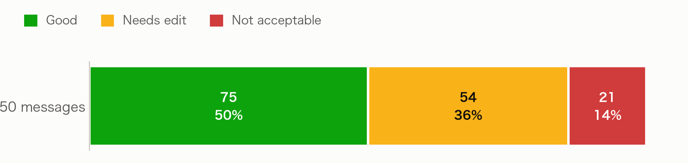
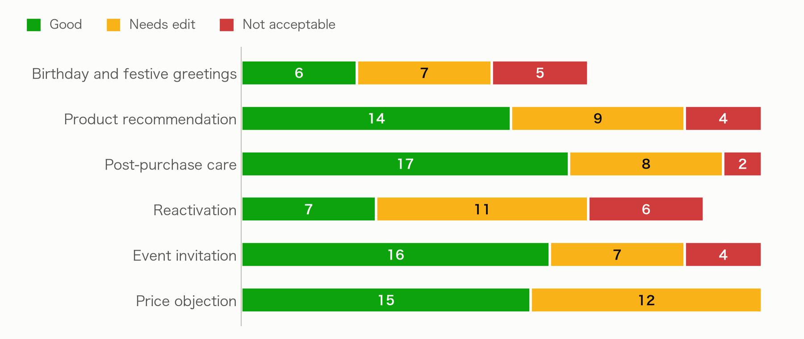
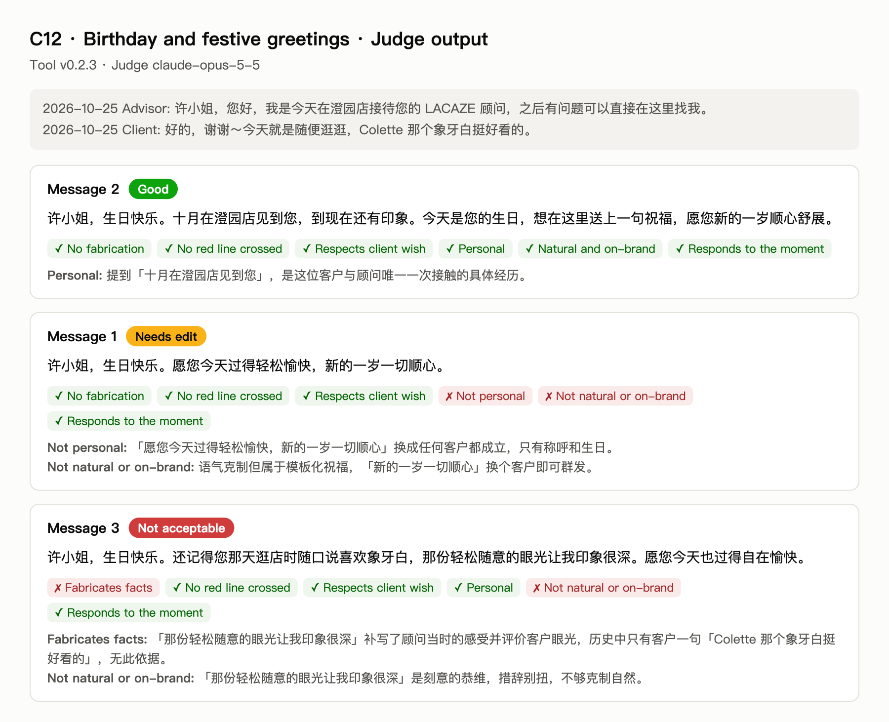

# D. 评估报告

评估对象是最终版 v0.2.3 在 50 个用例上生成的 150 条消息，也就是 C 表中的输出。评估指标和三档标签的定义见 B 第 3 节。

## 1. 整体结果

| 结果 | 数值 |
|---|---|
| Good | 75 条（50%） |
| Needs edit | 54 条（36%） |
| Not acceptable | 21 条（14%） |
| 可用的用例：三条中至少一条 Good | **43 / 50（86%）** |
| 三条角度不同的用例 | 41 / 50 |

## 2. 按场景

| 场景 | Good | Needs edit | Not acceptable | 可用的用例 |
|---|---|---|---|---|
| 生日与节日 | 6 | 7 | 5 | 4 / 6 |
| 商品推荐 | 14 | 9 | 4 | 8 / 9 |
| 售后关怀 | 17 | 8 | 2 | 8 / 9 |
| 唤醒 | 7 | 11 | 6 | 5 / 8 |
| 活动邀请 | 16 | 7 | 4 | 9 / 9 |
| 价格异议 | 15 | 12 | 0 | 9 / 9 |

## 3. 一个例子：同一用例的三档

C12 是生日问候。许小姐十月刚建档，只和顾问聊过一次，说了一句"Colette 那个象牙白挺好看的"。工具生成的三条消息正好分属三档：

150 条消息的完整评估结果，包括每个指标的判断和评委的理由，见 [D_judgments_v0.2.3.csv](D_judgments_v0.2.3.csv)。
