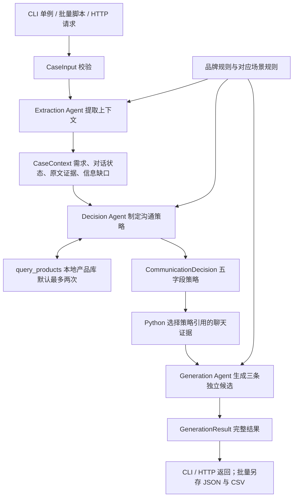

# LACAZE 项目接手导览

核对日期：2026-11-04。以下根据当前源代码及保存的运行记录整理；旧文档中的“本机”指之前的开发电脑。

## 从哪里开始看

- `docs/existing-results-v0.1.2.zh-CN.md`：已有十例、三十条实际生成话术的中文阅读版。
- `artifacts/review-v0.1.2/outputs.csv`：输入与三条输出的汇总表。
- `artifacts/review-v0.1.2/C02.json`：适合跟读的数据流实例，包含一次真实产品查询。
- `src/lacaze/application/workflow.py`：完整编排，是理解程序的主要入口。
- `docs/implementation.md`：旧开发过程、修改原因和已知问题。

## 运行时数据来源

`reference/` 中的 Markdown 是设计来源，程序不会直接读取这些文件。

| 运行文件 | 用途 |
| --- | --- |
| `data/cases/development.jsonl` | 十条结构化案例，每行一条；身份、历史、业务日期、商品/活动/服务事实 |
| `data/policies/brand.json` | 品牌设定和话术规则 |
| `data/policies/scenarios.json` | 六个场景各自的目标和规则 |
| `data/catalog/products.json` | 六款商品的本地只读产品库 |
| `data/prompts/extract.md` | 提取阶段的指令 |
| `data/prompts/decide.md` | 决策阶段的指令 |
| `data/prompts/generate.md` | 写作阶段的指令 |

修改 reference 不会自动更新运行配置，需要人工保持两者一致。

## 数据流



三个 Agent 使用同一个配置的模型，由 Python 固定顺序编排；不是三个独立后台服务。没有数据库、向量检索、前端或微信发送动作。

1. **输入校验**：固定六类场景、显式业务日期、历史按日期排列、消息 ID 唯一，历史不可晚于案例日期。场景由输入指定，不调用模型分类。
2. **上下文提取**：读取完整案例，提取需求、当前对话状态、关系/表达方式、相关产品、原文证据、信息缺口与矛盾。代码核对证据确实是原消息的子串，并从原消息补回说话人和日期。此阶段不重建永久客户档案。
3. **沟通决策**：读取提取结果、身份信息和产品事实，输出 `objective`、`content_focus`、`personalization_basis`、`communication_strategy`、`fact_boundaries`。只有此 Agent 能调用 `query_products`。
4. **产品查询**：仅查本地 JSON，可合并查询多款商品及多个字段。案例提供的商品快照优先于目录；未知尺寸、重量等保持未知。不能预约、预留商品或确认权益。
5. **话术生成**：读取决策、所引用的聊天证据、原始身份资料、提供/查得的事实和规则；不读取完整聊天或完整提取结果。一次输出三条互为备选的话术。
6. **保存**：批量程序保存原始输入、提取结果、决策、选中证据、商品查询、三条消息、版本、配置哈希及分阶段 token/请求数。

当前硬校验能检查结构、引用和 ID、三条文本互不相同且包含中文；不能保证语义正确、风格合适或三条差异足够大。没有独立的评审 Agent。

## 代码分工

| 路径 | 职责 |
| --- | --- |
| `src/lacaze/domain/models.py` | Pydantic 输入、中间结果、输出结构与校验 |
| `src/lacaze/application/workflow.py` | 三阶段编排和各阶段输入组装 |
| `src/lacaze/application/agents.py` | Agent 定义、规则注入、工具与证据校验 |
| `src/lacaze/application/batch.py` | 批量执行、并发限制、成功/失败落盘 |
| `src/lacaze/infrastructure/data.py` | 加载配置、案例及计算配置哈希 |
| `src/lacaze/infrastructure/catalog.py` | 本地产品查询及事实来源优先级 |
| `src/lacaze/infrastructure/settings.py` | 环境变量与 `.env` 配置 |
| `src/lacaze/infrastructure/provider.py` | Anthropic 兼容客户端连接 |
| `src/lacaze/interfaces/cli.py` | validate-data / generate / batch 命令 |
| `src/lacaze/interfaces/api.py` | FastAPI health / scenarios / generate 接口 |
| `scripts/run_cases.py` | 为 CLI 自动补上 batch 子命令的便捷入口 |

## 两类测试要分清

**离线工程测试**：`tests/` 使用 FunctionModel 模拟模型返回，但实际执行 Agent 编排和工具循环；检查输入、证据、工具预算、请求隔离、API、批量导出和失败记录。不需要 key，不评估中文话术质量。

**实际案例运行**：`scripts/run_cases.py` 或 `lacaze batch` 使用配置的大模型，需要有效服务地址、模型名称和凭据，会产生模型调用。案例来源默认是 `data/cases/development.jsonl`。

在项目目录中运行：

```sh
uv sync --locked
uv run lacaze validate-data
uv run pytest -q
uv run ruff check src scripts tests
```

配置真实模型之后才运行：

```sh
uv run lacaze generate --case-id C01
uv run python scripts/run_cases.py --case-ids C02 C07 --output-dir artifacts/new-local-run
uv run uvicorn lacaze.interfaces.api:app --host 127.0.0.1 --port 8000
```

`new-local-run` 必须是不存在的新目录。API 的 `/docs` 是交互接口文档，不是业务前端。当前 API 启动时就要求凭据，即使只访问 health；health 本身不验证模型可用性。

## 旧结果的状态

- `pilot-c02`：早期失败样例，保留结构校验问题。
- `development-v0.1.1`：旧版十例完整运行，可做前后对照。
- `development-v0.1.2`：中断的初步批次，不作为最终结果。
- `development-v0.1.2-final`：8 成功、2 失败。
- `recheck-v0.1.2`：C06 成功，C07 失败。
- `recheck-c07-v0.1.2`：C07 仍失败。
- `recheck-c07-delayed-v0.1.2`：C07 成功。
- `review-v0.1.2`：上述同版本成功记录的汇总，10 例、30 条话术；来源运行有 14 次案例尝试、4 次失败。

每例 JSON 包含完整过程；CSV 便于看输入/输出；`summary.json` 记录执行统计；`configuration.json` 保存当时的提示词、规则和产品库。它们不是正式质量评估报告。

阅读输出可见尚待改进的问题：C02 偏长且三条相似，仍承诺后续核对资料；C08 把客户一次提到扣子写成“反复”或“两次”；C05 有主动推进预约的倾向。这些问题不是格式校验能发现的。

## API 配置边界

程序读取 `ANTHROPIC_AUTH_TOKEN` 或 `ANTHROPIC_API_KEY`；地址来自 `ANTHROPIC_BASE_URL`；模型名称优先使用 `LACAZE_MODEL`，其次 `ANTHROPIC_MODEL`。

旧默认地址 `http://localhost:6655/anthropic` 指向旧电脑的本地代理，不是公共模型服务。旧记录中的模型名为 `claude-opus-4-8`；它是历史配置/记录，不能据此认定新服务商支持该标识。

接入新的服务时，需同时确认 Anthropic 接口兼容性、服务地址、实际模型标识和 key。仅提供 OpenAI 兼容接口的 key 无法直接用于当前 provider。

## 本机环境整理结果（2026-11-04）

- 日常 zsh 的 `python`、`python3`：uv 管理的 Python 3.13.13。
- `pip`、`pip3`：均绑定同一套 Python 3.13.13，pip 26.1.2。
- 活跃 uv：`~/.local/bin/uv`，版本 0.13.7；已移除重复的 Homebrew uv 0.9.21，并清除本轮临时项目 uv 安装副本。
- 已从 `.zprofile` 移除旧 Python Framework 的 PATH 优先配置；`.zprofile`、`.zshrc` 统一用户命令路径并去重，同时保留已激活虚拟环境的优先级。
- 系统 Python 3.9.6 和手动安装的 3.10.11、3.12.8 保留兼容用途，不再是日常终端默认版本。没有批量改动其他项目的解释器或依赖。
- 配置和旧用户级 uv 文件备份：`/Users/jamie/.local/state/python-cleanup/20261104-190029/`，含 `manifest.json`。
- Python 的实际安装目录：`/Users/jamie/.local/share/uv/python/cpython-3.13.13-macos-aarch64-none/`。
- 项目虚拟环境：`/Users/jamie/Documents/Artefact/lacaze-advisor/.venv/`；按原 `uv.lock` 安装，未修改依赖声明和锁文件。

重开终端以加载默认配置。项目内使用 `uv run`，无须手动激活；也可以 `source .venv/bin/activate`。不要将其他项目的包搬入全局环境。uv 管理的基础解释器标记为 externally managed，普通全局 pip 安装可能被拒绝，这是隔离保护；项目依赖应安装在虚拟环境中。

## 本机验证结果

- `lacaze validate-data`：10 例、6 个场景全部覆盖、6 款商品；配置哈希与旧 v0.1.2 汇总一致。
- `pytest -q`：17 passed in 2.43s。
- `ruff check src scripts tests`：All checks passed。
- `uv run --locked --offline python`：确认使用项目 `.venv` 的 Python 3.13.13。
- zsh 配置语法检查通过；登录/交互终端的 Python 和 pip 指向一致；激活 `.venv` 后新开嵌套 shell 仍优先使用项目解释器。

当前没有应用可读取的 Anthropic key，项目没有 `.env`，旧模型代理未运行。没有调用真实模型，也没有启动持续运行的真实模型 API 服务；HTTP 行为通过测试中的模拟模型验证。

后续在项目目录中可直接运行：

```sh
uv run lacaze validate-data
uv run pytest -q
uv run ruff check src scripts tests
```

## 离线测试的输入与输出

`tests/conftest.py` 中的 `ScriptedModel` 通过 PydanticAI `FunctionModel` 模拟模型响应，不联网。输入使用真实的开发案例结构；输出是测试作者预设的结构化上下文、策略、工具调用和三条中文消息。

例如，C02 的模拟生成结果为：

1. 林女士，这两款可以先了解一下。
2. 林女士，先接着您上次提到的需求聊聊。
3. 林女士，您可以按自己的节奏慢慢看。

这些不是原有真实模型生成结果，也不是理想答案。测试检查程序是否按约定处理这些响应，例如：引用校验、产品查询最多两次、只给写作阶段传选定证据、并发客户数据隔离、缺少业务日期返回 422、失败记录不伪造输出。

离线测试通过不能证明模型理解正确、提示词有效或话术质量达标。已有实际话术仍保存在 `artifacts/review-v0.1.2/`；按用户要求，本轮不开展话术质量评估或行业调研。
