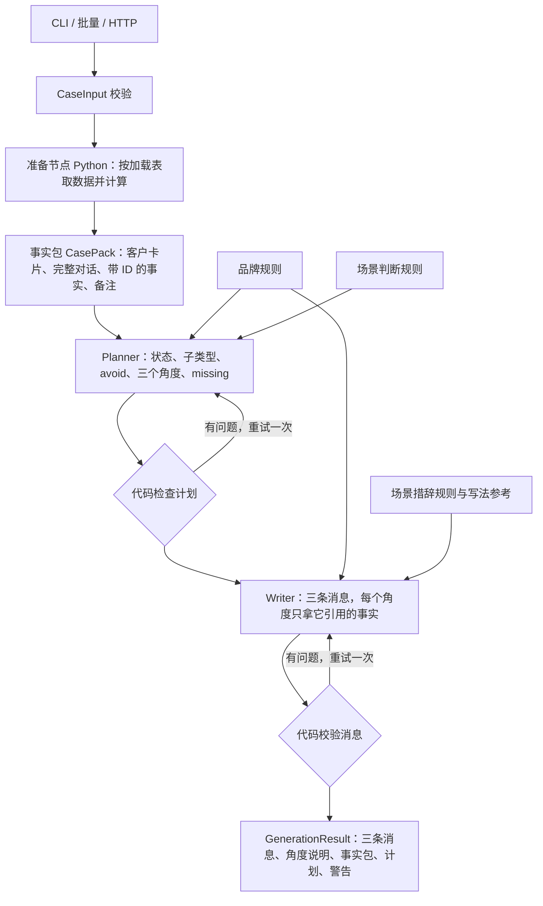

# LACAZE 项目接手导览

核对日期：2026-11-04。以下根据当前源代码及保存的运行记录整理；旧文档中的“本机”指之前的开发电脑。

## 从哪里开始看（v0.2）

- `src/lacaze/application/workflow.py`：完整编排，是理解程序的主要入口。
- `data/context/loading.json`：场景 × 数据加载表，决定每个场景带哪些数据。
- `data/prompts/plan.md`、`data/prompts/write.md`：Planner 和 Writer 的指令。
- `docs/existing-results-v0.1.2.zh-CN.md`：v0.1.2 的十例、三十条话术，作为改动前的对照。

## 运行时数据来源

`reference/` 中的 Markdown 是设计来源，程序不会直接读取这些文件。

| 运行文件 | 用途 |
| --- | --- |
| `data/cases/development.jsonl` | 开发集，十条案例：场景、业务日期、客户 ID、对话历史、商品和活动 ID |
| `data/foundation/` | 数据基建：品牌、场景规则、商品、服务、政策、活动、节日、客户与消费记录，见其中的 README |
| `data/context/loading.json` | 场景 × 数据加载表：每个场景带哪些商品字段、服务、政策、活动、节日、上次联系 |
| `data/context/guardrail.json` | 对话术的代码校验：长度上限、内部词；禁用说法与评估共用 `data/evaluation/checks.json` |
| `data/prompts/plan.md` / `write.md` | Planner / Writer 的指令 |
| `data/prompts/writer_examples.json` | 每个场景一条虚构的写法参考 |

已知客户只写 `client_id`，身份、累计消费、层级和购买记录都从 foundation 计算。新客户可以把称呼等信息直接写在 `client_information` 里，此时视为没有消费记录。

## 数据流



这是固定顺序的 workflow，不是自主 agent：路由由场景决定，没有工具调用，每个 LLM 环节一次调用，加最多一次带反馈的重试。

1. **准备（Python）**：按 `loading.json` 取本场景要用的数据：
   - 商品只取 case 给出的、活动介绍的、对话里提到的几款，并且只取本场景需要的字段；客户已有的款以购买记录的形式出现。
   - 服务和政策按场景筛选，配货规则只在涉及配额款时才带。
   - 计算累计消费、层级、距购买天数、活动资格、生日和节日距今天数、上次联系。
   - 对生成宽松：认不出的商品或活动 ID 记为备注，交给 Planner。`validate-data` 对测试集仍然严格。
2. **Planner**：看到客户卡片（含内部层级）、完整对话、全部事实。输出客户状态、子类型、avoid、三个角度（引用的对话编号和事实 ID）和 missing。代码检查编号和 ID 存在、子类型合法、三个角度的依据不同。
3. **Writer**：看到称呼、完整对话、计划，每个角度只看到它引用的事实；引用的原话由代码按编号取出。一次写三条。
4. **校验（Python）**：
   - 硬问题：价格、日期、时间不在事实中，提到不相关的商品，内部词，禁用说法，缺称呼，超过 200 字，用了别的角度的事实。出现硬问题会重试一次，仍有问题时照常返回并附警告，由 CA 把关。
   - 软警告：感叹号，非价格场景出现折扣词，三条太相似。只提示，不重试。

## 代码分工

| 路径 | 职责 |
| --- | --- |
| `src/lacaze/domain/models.py` | 输入、规则、三条候选的结构与校验 |
| `src/lacaze/domain/pack.py` | 事实包、客户卡片、加载表、校验配置 |
| `src/lacaze/domain/plan.py` / `result.py` | Planner 与 Writer 输出；完整结果 |
| `src/lacaze/domain/text.py` | 价格、日期、时间、商品名识别，运行时与评估共用 |
| `src/lacaze/application/preparation.py` | 准备节点 |
| `src/lacaze/application/fact_text.py` | 把 foundation 记录写成一条条中文事实 |
| `src/lacaze/application/agents.py` | Planner / Writer 定义与分层指令 |
| `src/lacaze/application/plan_checks.py` / `guardrail.py` | 计划检查、消息校验 |
| `src/lacaze/application/workflow.py` | 编排，以及 Planner / Writer 的输入 |
| `src/lacaze/application/batch.py` | 批量执行与导出 |
| `src/lacaze/infrastructure/` | 读取数据、foundation 查询、配置、模型连接 |
| `src/lacaze/interfaces/` | CLI 与 FastAPI |
| `src/lacaze/evaluation/` | 评估：评审材料、代码检查、汇总与报告 |

## 两类测试要分清

**离线工程测试**：`tests/` 使用 FunctionModel 模拟模型返回，但实际执行编排、重试和校验；检查准备节点、分层指令、引用与校验、重试后的警告、请求隔离、API、批量导出和失败记录。不需要 key，不评估中文话术质量。

**实际案例运行**：`scripts/run_cases.py` 或 `lacaze batch` 使用配置的大模型，需要有效服务地址、模型名称和凭据，会产生模型调用。案例来源默认是 `data/cases/development.jsonl`。

在项目目录中运行：

```sh
uv sync --locked
uv run lacaze validate-data
uv run pytest -q
uv run ruff check src scripts tests
```

配置真实模型之后才运行：

```sh
uv run lacaze generate --case-id C01
uv run python scripts/run_cases.py --case-ids C02 C07 --output-dir artifacts/new-local-run
uv run uvicorn lacaze.interfaces.api:app --host 127.0.0.1 --port 8000
```

`new-local-run` 必须是不存在的新目录。API 的 `/docs` 是交互接口文档，不是业务前端。当前 API 启动时就要求凭据，即使只访问 health；health 本身不验证模型可用性。

## 旧结果的状态

- `pilot-c02`：早期失败样例，保留结构校验问题。
- `development-v0.1.1`：旧版十例完整运行，可做前后对照。
- `development-v0.1.2`：中断的初步批次，不作为最终结果。
- `development-v0.1.2-final`：8 成功、2 失败。
- `recheck-v0.1.2`：C06 成功，C07 失败。
- `recheck-c07-v0.1.2`：C07 仍失败。
- `recheck-c07-delayed-v0.1.2`：C07 成功。
- `review-v0.1.2`：上述同版本成功记录的汇总，10 例、30 条话术；来源运行有 14 次案例尝试、4 次失败。

每例 JSON 包含完整过程；CSV 便于看输入/输出；`summary.json` 记录执行统计；`configuration.json` 保存当时的提示词、规则和产品库。它们不是正式质量评估报告。

阅读输出可见尚待改进的问题：C02 偏长且三条相似，仍承诺后续核对资料；C08 把客户一次提到扣子写成“反复”或“两次”；C05 有主动推进预约的倾向。这些问题不是格式校验能发现的。

## API 配置边界

程序读取 `ANTHROPIC_API_KEY`（或代理用的 `ANTHROPIC_AUTH_TOKEN`）；模型名称优先使用 `LACAZE_MODEL`，默认 `claude-sonnet-5-5`。不设 `ANTHROPIC_BASE_URL` 时直接连接 Anthropic 官方 API；只有走代理时才需要设置它。

API key 需要在 Claude Console（platform.claude.com）单独充值后创建，Claude app 的套餐额度不是 API key。把 `.env.example` 复制为 `.env` 并填入即可。

旧记录中的 `http://localhost:6655/anthropic` 和 `claude-opus-4-8` 来自旧电脑的公司代理，只是历史配置。

## 本机环境整理结果（2026-11-04）

- 日常 zsh 的 `python`、`python3`：uv 管理的 Python 3.13.13。
- `pip`、`pip3`：均绑定同一套 Python 3.13.13，pip 26.1.2。
- 活跃 uv：`~/.local/bin/uv`，版本 0.13.7；已移除重复的 Homebrew uv 0.9.21，并清除本轮临时项目 uv 安装副本。
- 已从 `.zprofile` 移除旧 Python Framework 的 PATH 优先配置；`.zprofile`、`.zshrc` 统一用户命令路径并去重，同时保留已激活虚拟环境的优先级。
- 系统 Python 3.9.6 和手动安装的 3.10.11、3.12.8 保留兼容用途，不再是日常终端默认版本。没有批量改动其他项目的解释器或依赖。
- 配置和旧用户级 uv 文件备份：`/Users/jamie/.local/state/python-cleanup/20261104-190029/`，含 `manifest.json`。
- Python 的实际安装目录：`/Users/jamie/.local/share/uv/python/cpython-3.13.13-macos-aarch64-none/`。
- 项目虚拟环境：`/Users/jamie/Documents/Artefact/lacaze-advisor/.venv/`；按原 `uv.lock` 安装，未修改依赖声明和锁文件。

重开终端以加载默认配置。项目内使用 `uv run`，无须手动激活；也可以 `source .venv/bin/activate`。不要将其他项目的包搬入全局环境。uv 管理的基础解释器标记为 externally managed，普通全局 pip 安装可能被拒绝，这是隔离保护；项目依赖应安装在虚拟环境中。

## 本机验证结果

- `lacaze validate-data`：10 例、6 个场景全部覆盖、6 款商品（v0.2.0，2026-11-07）。
- `pytest -q`：52 passed（v0.2.0，2026-11-07）。
- `ruff check src scripts tests`：All checks passed。
- `uv run --locked --offline python`：确认使用项目 `.venv` 的 Python 3.13.13。
- zsh 配置语法检查通过；登录/交互终端的 Python 和 pip 指向一致；激活 `.venv` 后新开嵌套 shell 仍优先使用项目解释器。

截至 2026-11-07，项目还没有 `.env`，也就没有可用的 API key。v0.2 还没有用真实模型跑过。没有调用真实模型，也没有启动持续运行的真实模型 API 服务；HTTP 行为通过测试中的模拟模型验证。

后续在项目目录中可直接运行：

```sh
uv run lacaze validate-data
uv run pytest -q
uv run ruff check src scripts tests
```

## 离线测试的输入与输出

`tests/conftest.py` 中的 `ScriptedModel` 通过 PydanticAI `FunctionModel` 模拟模型响应，不联网。输入使用真实的开发案例结构；输出是测试作者预设的计划和三条中文消息，可以设定为第一次或每次都出错，用来测重试和警告。

例如，C02 的模拟生成结果为：

1. 林女士，这两款可以先了解一下。
2. 林女士，先接着您上次提到的需求聊聊。
3. 林女士，您可以按自己的节奏慢慢看。

这些不是原有真实模型生成结果，也不是理想答案。测试检查程序是否按约定处理这些响应，例如：Planner 看到内部层级而 Writer 看不到、Writer 每个角度只拿到引用的事实、计划和消息出错时重试、重试后仍有问题时带警告返回、并发客户数据隔离、缺少业务日期返回 422、失败记录不伪造输出。

离线测试通过不能证明模型理解正确、提示词有效或话术质量达标。v0.1.2 的实际话术和评估保存在 `artifacts/review-v0.1.2/` 与 `artifacts/eval-review-v0.1.2-rubric2/`。
